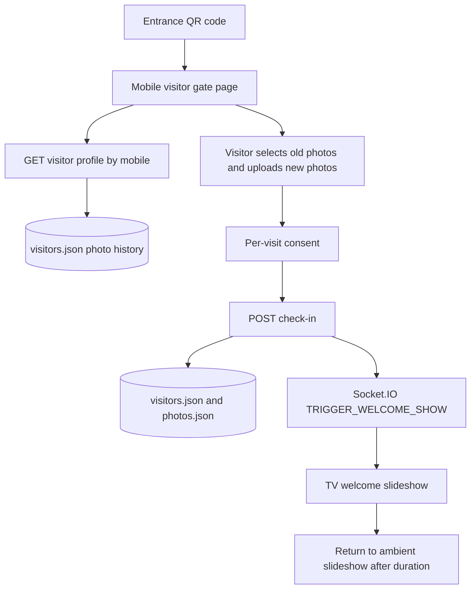

# Architecture — Visitor Photo Slideshow

## Stack decisions
- **Node.js + Express:** serves the visitor gate, QR generator, admin interface, TV page, and REST APIs.
- **Socket.IO:** sends real-time welcome slideshow events to connected TV displays.
- **Local JSON files:** preserve the supplied project storage approach for a small demo; a database such as MongoDB or PostgreSQL is preferable for production.
- **HTML/CSS/JavaScript:** visitor mobile-friendly check-in interface and TV web app.
- **LG webOS web app:** runs the existing TV display interface.

## Data model (simplified)
- Visitor check-in record: `id`, `profileId`, `name`, `phone`, `photos` (selected for this check-in), `photoHistory` (profile's retained photo URLs), `consentToDisplay`, `status`, `timestamp`.
- Ambient photo: `id`, `url`, `title`, `uploadedAt`.
- Settings: auto-approval, welcome duration, ambient slide interval, residence name.

## Flow

## Security considerations
- Consent is required for each public TV display.
- Uploads are constrained by file count, size, MIME/extension allowlist, and signature checks.
- Mobile-number matching is demo-only without OTP; production should verify identity and add admin authentication, HTTPS, retention/deletion controls, and access restrictions for stored images.
